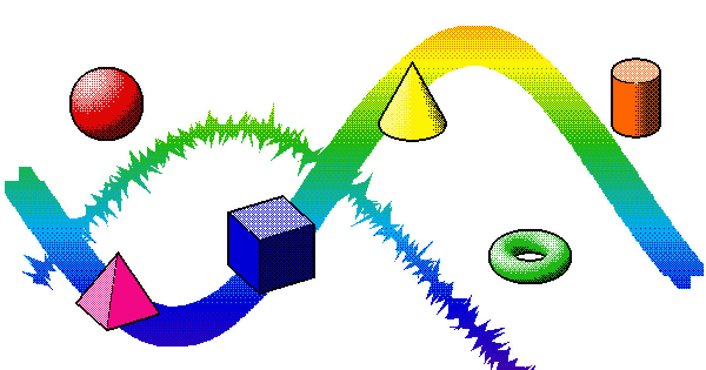

# MacTint

*Lire en français : [README.fr.md](README.fr.md)*

A bitmap paint program in sixteen colours where every gesture plays a note. MacTint starts
from MacPaint (1984) and takes it somewhere else: colour, pattern, movement and sound.

**Try it online: <https://etienne.design/tools/mactint/>**



## What it does

- **The twenty classic tools** of MacPaint, with the 38 original patterns, in the sixteen
  colours of the Macintosh II, plus your own colours.
- **Some sixty more tools**, in five families: *Draw* (living brush, barbed brush, jelly
  line, paper ribbon…), *Effects* (acid, glitch, melting brush, dynamite…), *Life*
  (caterpillar, flying spheres, fly away…), *Cycle* (colour cycling) and *3D* (six solids
  drawn by ray marching, shaded with dither).
- **One pen width for everything**, from 1 to 200 points: every tool follows it.
- **Gradients**: dither or line gradients between two colours, and four rainbow modes.
- **Layers**, pages up to 2048 points, PNG and animated GIF export.
- **Sound**: each tool has its own voice, rhythm and drum kit, all synthesised live. The
  music comes only from what you do. No gesture, no sound.
- **Space bar**: everything that moves freezes exactly as you see it.

## Run it locally

No build step and no dependency. Serve the folder with any static web server:

```bash
python3 -m http.server 8000
```

Then open <http://localhost:8000/>.

## Files

| File | Content |
|---|---|
| `index.html` | The page: one canvas and three scripts. |
| `colorpaint.js` | The whole application: interface, tools, effects, export. |
| `studio.js` | The sound engine (Web Audio, no audio file). |
| `classic-data.js` | Original MacPaint and Macintosh reference data. **Not MIT**, see below. |
| `preview.png` | Preview image, drawn in MacTint. |

The script is still called `colorpaint.js`: MacTint was first named ColorPaint.

## Licence

The code is released under the [MIT licence](LICENSE).

`classic-data.js` contains fonts and resources from original Apple software. They remain the
property of Apple Inc. and are **not** covered by the MIT licence: read
[THIRD_PARTY_NOTICES.md](THIRD_PARTY_NOTICES.md) before reusing this project.

MacTint is an unofficial tribute. It is not affiliated with Apple.

Designed and imagined by Étienne Mineur, November 2026.
